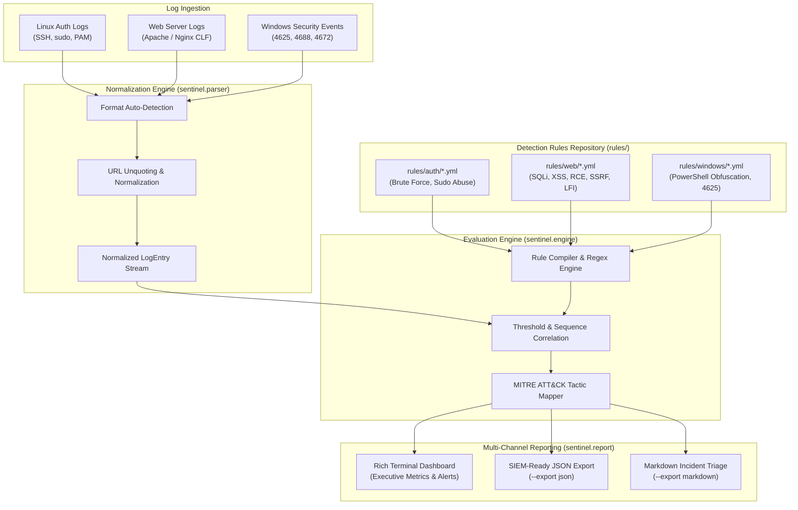

# 🛡️ SOC Log Sentinel (`soc-log-sentinel`)

[](https://www.python.org/)
[](https://opensource.org/licenses/MIT)
[]()
[]()
[](https://github.com/psf/black)

> **Enterprise SOC Log Analysis & Detection Engineering Toolkit.**  
> Transforms raw multi-platform logs into normalized security telemetry, evaluates Sigma-inspired YAML detection rules, correlates attack vectors against the **MITRE ATT&CK Enterprise Framework**, and renders interactive terminal dashboards via `Rich` alongside SIEM-ingestible JSON and Markdown triage reports.

---

## 📌 Executive Overview

Security Operations Centers (SOCs) and Incident Response teams face overwhelming log volumes, alert fatigue, and heterogeneous log schemas across Linux, Web, and Windows infrastructure. **SOC Log Sentinel** provides an enterprise-grade, lightweight, and modular detection engineering pipeline designed to triage attacks rapidly without the overhead of heavy SIEM infrastructure:

- **Multi-Source Ingestion & Normalization:** Ingests Linux authentication logs (`auth.log`), Web server access logs (Apache/Nginx Combined Log Format), and Windows Security Event logs (Event IDs 4625, 4624, 4688, 4672).
- **Sigma-Inspired YAML Detection Logic:** All threat detection logic is decoupled into declarative, version-controlled YAML rules inside `rules/`, supporting both threshold-based clustering and high-precision regex signatures.
- **Strict MITRE ATT&CK Alignment:** Every detection rule is explicitly tagged with MITRE ATT&CK Tactics, Technique IDs (e.g., `T1110.001`, `T1059.001`, `T1190`), and remediation playbooks.
- **Sleek Rich Terminal Interface:** Renders color-coded severity badges, executive incident metrics, and tactic breakdown matrices right in the analyst console.
- **Dual Pipeline Outputs:** Exports machine-readable structured JSON for ingestion into Splunk, Elastic, or Microsoft Sentinel, and formatted Markdown for SOC shift-handover tickets.

---

## 🏗️ System Architecture & Workflow

```text
┌─────────────────────────────────────────────────────────────────────────────┐
│                             LOG INGESTION LAYER                             │
│   Linux /var/log/auth.log   •   Apache/Nginx Access Logs   •   Windows Events  │
└──────────────────────────────────────┬──────────────────────────────────────┘
                                       │
                                       ▼
┌─────────────────────────────────────────────────────────────────────────────┐
│                     NORMALIZATION & PARSING (sentinel.parser)               │
│      Auto Dialect Detection  •  URL Percent-Decoding  •  Field Normalization │
└──────────────────────────────────────┬──────────────────────────────────────┘
                                       │
                                       ▼
┌─────────────────────────────────────────────────────────────────────────────┐
│                 DETECTION & EVALUATION ENGINE (sentinel.engine)             │
│   Sigma-Inspired YAML Rules (rules/)  •  Regex Pattern & Threshold Matcher   │
│                 MITRE ATT&CK Tagging & Threat Actor Aggregation             │
└──────────────────────────────────────┬──────────────────────────────────────┘
                                       │
                                       ▼
┌─────────────────────────────────────────────────────────────────────────────┐
│                         MULTI-CHANNEL REPORTING LAYER                       │
│    Rich Terminal UI (Color Badges)  •  SIEM JSON Export  •  Markdown Triage │
└─────────────────────────────────────────────────────────────────────────────┘
```

### Ingestion & Correlation Flow (Mermaid)



---

## 📁 Modular Directory Layout

```text
soc-log-sentinel/
├── sentinel/                   # Core Detection Engineering Package
│   ├── __init__.py             # Package exports & version metadata (v2.0.0)
│   ├── cli.py                  # CLI interface, argument parser & pipeline runner
│   ├── parser.py               # Multi-source log parser (Auth, Web, Windows)
│   ├── engine.py               # YAML rule loader & MITRE correlation engine
│   └── report.py               # Rich terminal visualizer & SIEM JSON/MD exporter
├── rules/                      # Declarative Detection Rules (Sigma-Inspired YAML)
│   ├── auth/
│   │   ├── ssh_brute_force.yml         # T1110.001 - Password Guessing
│   │   ├── ssh_invalid_user.yml        # T1087.001 - Account Discovery
│   │   └── sudo_privilege_abuse.yml    # T1548.003 - Sudo Privilege Abuse
│   ├── web/
│   │   ├── sqli_injection.yml          # T1190 - SQL Injection
│   │   ├── path_traversal.yml          # T1083 - File & Directory Discovery
│   │   ├── command_injection.yml       # T1059.004 - OS Command Execution (RCE)
│   │   ├── ssrf_cloud_metadata.yml     # T1190 - IMDS Cloud SSRF
│   │   └── xss_injection.yml           # T1189 - Cross-Site Scripting
│   └── windows/
│       ├── suspicious_powershell.yml   # T1059.001 - PowerShell Obfuscation
│       ├── logon_brute_force.yml       # T1110 - Windows Event 4625 Burst
│       └── privilege_escalation_4672.yml # T1078 - Sensitive Privilege Assignment
├── samples/                    # Curated Threat Samples for Instant Evaluation
│   ├── auth.log                # Linux SSH brute force & sudo failure events
│   ├── access.log              # OWASP Top 10 Web injection attack payloads
│   └── windows_security.log    # Windows Event 4625 failed logons & PowerShell RCE
├── tests/                      # Enterprise Pytest Suite (100% Pass Rate)
│   ├── test_cli.py             # CLI options, arguments, and exit code tests
│   ├── test_engine.py          # Rule parsing, regex matching, and threshold logic
│   ├── test_parser.py          # Multi-format parsing, decoding, and edge cases
│   └── test_report.py          # Rich terminal rendering and JSON schema integrity
├── .github/workflows/          # CI Automation
│   └── ci.yml                  # Multi-version matrix test (Python 3.10 - 3.13)
├── .gitignore                  # Production Git hygiene configuration
├── LICENSE                     # MIT License
├── pyproject.toml              # Modern PEP 517/621 packaging standard
└── requirements.txt            # Runtime dependencies (rich, ruamel.yaml, pytest)
```

---

## ⚡ Quickstart Guide

### 1. Installation

```bash
# Clone the repository
git clone https://github.com/hsan001/soc-log-sentinel.git
cd soc-log-sentinel

# Install dependencies
pip install -r requirements.txt

# (Optional) Install as local editable CLI utility
pip install -e .
```

### 2. Fast Evaluation (One-Command Run)

Analyze Linux authentication logs with interactive terminal tables:
```bash
python -m sentinel.cli --file samples/auth.log --rules rules/
```

Ingest multi-platform logs simultaneously (Linux Auth, Web Access, Windows Events):
```bash
python -m sentinel.cli samples/auth.log samples/access.log samples/windows_security.log
```

Export structured JSON telemetry for SIEM ingestion:
```bash
python -m sentinel.cli samples/access.log --export json -j triage_report.json
```

Generate both formatted Markdown report and SIEM JSON with custom brute-force threshold:
```bash
python -m sentinel.cli samples/auth.log --threshold 3 --export both -j report.json -m report.md
```

---

## 🖥️ Sample Terminal Output

When executed, **SOC Log Sentinel** generates an interactive `Rich` incident dashboard:

```text
┌─────────────────────────────────────────────────────────────────────────────┐
│ 🛡️  SOC LOG SENTINEL v2.0.0 — Enterprise Detection & Incident Triage Engine │
│ MITRE ATT&CK Aligned Detection Engineering Framework                        │
└─────────────────────────────────────────────────────────────────────────────┘
┌──────────────────────── EXECUTIVE INCIDENT SUMMARY ─────────────────────────┐
│                                                                             │
│    Log Sources Analyzed:   3 files (41 events)    Threat Severity:   Critical: 8  │
│                                                                      High: 9      │
│    Total Alerts Flagged:   18 incidents           Unique Attackers:  9 source IPs │
│                                                                                   │
└─────────────────────────────────────────────────────────────────────────────┘
                 🚨 DETECTED SECURITY INCIDENTS & THREAT VECTORS               
┌──────────┬──────────────┬──────────────────────────┬──────────────────┬─────────────┬───────────────────────────────┬───────┐
│ Alert ID │   Severity   │ Rule & Threat Vector     │ Source -> Target │ MITRE ATT&CK│ Observed Evidence / Payload   │  Hits │
├──────────┼──────────────┼──────────────────────────┼──────────────────┼─────────────┼───────────────────────────────┼───────┤
│ ALT-001  │   CRITICAL   │ Web SQL Injection (SQLi) │ 198.51.100.24    │ T1190       │ ' OR '1'='1                   │     1 │
│          │              │                          │ -> /login.php    │ Exploit App │                               │       │
├──────────┼──────────────┼──────────────────────────┼──────────────────┼─────────────┼───────────────────────────────┼───────┤
│ ALT-002  │   CRITICAL   │ OS Command Injection     │ 45.33.32.156     │ T1059.004   │ ; cat /etc/passwd             │     1 │
│          │              │                          │ -> /cgi-bin/ping │ Unix Shell  │                               │       │
├──────────┼──────────────┼──────────────────────────┼──────────────────┼─────────────┼───────────────────────────────┼───────┤
│ ALT-003  │   CRITICAL   │ Suspicious PowerShell    │ 10.0.0.45        │ T1059.001   │ -ExecutionPolicy Bypass -enc  │     1 │
│          │              │ Obfuscation & Download   │ -> powershell.exe│ PowerShell  │                               │       │
├──────────┼──────────────┼──────────────────────────┼──────────────────┼─────────────┼───────────────────────────────┼───────┤
│ ALT-004  │     HIGH     │ SSH Password Brute Force │ 192.168.1.105    │ T1110.001   │ 7 failed attempts observed.   │     7 │
│          │              │ Attack                   │ -> sshd          │ Passw Guess │                               │       │
└──────────┴──────────────┴──────────────────────────┴──────────────────┴─────────────┴───────────────────────────────┴───────┘
```

---

## 🎯 MITRE ATT&CK Coverage Matrix

| Rule ID | Detection Rule Name | MITRE Tactic | Technique ID | Technique Name | Severity |
|:---|:---|:---|:---:|:---|:---:|
| **`SEC-AUTH-001`** | SSH Password Brute Force | Credential Access | **`T1110.001`** | Password Guessing | `High` |
| **`SEC-AUTH-002`** | SSH Invalid User Enumeration | Discovery | **`T1087.001`** | Local Account Discovery | `Medium` |
| **`SEC-AUTH-003`** | Sudo Privilege Abuse | Privilege Escalation | **`T1548.003`** | Sudo & Sudo Caching | `High` |
| **`SEC-WEB-001`** | Web SQL Injection (SQLi) | Initial Access | **`T1190`** | Exploit Public-Facing App | `Critical` |
| **`SEC-WEB-002`** | Path Traversal & LFI | Discovery | **`T1083`** | File & Directory Discovery | `High` |
| **`SEC-WEB-003`** | OS Command Injection (RCE) | Execution | **`T1059.004`** | Unix Shell | `Critical` |
| **`SEC-WEB-004`** | Cloud Metadata SSRF (IMDS) | Initial Access | **`T1190`** | Exploit Public-Facing App | `Critical` |
| **`SEC-WEB-005`** | Cross-Site Scripting (XSS) | Initial Access | **`T1189`** | Drive-by Compromise | `High` |
| **`SEC-WIN-001`** | Suspicious PowerShell RCE | Execution | **`T1059.001`** | PowerShell | `Critical` |
| **`SEC-WIN-002`** | Windows Event 4625 Burst | Credential Access | **`T1110`** | Brute Force | `High` |
| **`SEC-WIN-003`** | Sensitive Privilege Assignment | Privilege Escalation | **`T1078`** | Valid Accounts | `Medium` |

---

## ✍️ Authoring Custom YAML Detection Rules

Adding new detection logic is as simple as dropping a `.yml` file into `rules/`:

```yaml
id: SEC-WEB-006
name: Log4Shell JNDI Exploit Attempt
description: Detects JNDI LDAP lookup strings attempting Remote Code Execution via CVE-2021-44228.
severity: Critical
log_type: web
mitre:
  tactic: Initial Access
  technique_id: T1190
  technique_name: "Exploit Public-Facing Application"
detection:
  type: pattern
  target_field: target
  patterns:
    - '(?i)\$\{jndi:(?:ldap|rmi|dns|nis|iiop)://'
remediation: Upgrade log4j dependencies to >=2.17.1 and set -Dlog4j2.formatMsgNoLookups=true.
```

---

## 🧪 Testing & Verification

The test suite validates parsing robustness, threshold boundary limits, regex pattern precision, and JSON schema compatibility:

```bash
# Run full automated unit test suite
python -m pytest tests/ -v
```

```text
============================= test session starts =============================
platform win32 -- Python 3.15.0, pytest-9.2.0, pluggy-1.7.0
rootdir: C:\Users\G14\Desktop\ANTIGRAVITY\soc-log-sentinel
collected 32 items

tests/test_cli.py::test_cli_version PASSED                               [  3%]
tests/test_cli.py::test_cli_sample_auth_evaluation PASSED                [ 12%]
tests/test_cli.py::test_cli_json_export PASSED                           [ 15%]
tests/test_engine.py::test_rule_loading_and_mitre_mapping PASSED         [ 21%]
tests/test_engine.py::test_sqli_detection PASSED                         [ 25%]
tests/test_engine.py::test_powershell_obfuscation_detection PASSED       [ 34%]
tests/test_engine.py::test_ssh_brute_force_threshold_trigger PASSED      [ 37%]
tests/test_parser.py::test_parse_windows_event_4688_powershell PASSED    [ 71%]
tests/test_report.py::test_json_report_serialization PASSED              [ 90%]
tests/test_report.py::test_rich_terminal_rendering PASSED                [100%]

============================= 32 passed in 0.54s ==============================
```

---

## 🗺️ Engineering Roadmap

- [x] **v2.0.0:** Modular Python architecture (`sentinel/`), Sigma YAML rules, Windows Event Log parsing, Rich terminal UI.
- [ ] **v2.1.0:** Direct Splunk HTTP Event Collector (HEC) and Elasticsearch bulk ingestion forwarder.
- [ ] **v2.2.0:** Sigma Rule Transpiler (`sigma-cli` integration to automatically compile community Sigma rules).
- [ ] **v2.3.0:** Zeek & Suricata network alert PCAP cross-correlation engine.

---

## 👤 Author & License

- **Author:** Mohammad Hassan Jalal ([@hsan001](https://github.com/hsan001))
- **Email:** hsanjlallko@gmail.com
- **Specialization:** Applied Cybersecurity, SOC Log Analysis, VAPT & AppSec Engineering
- **License:** Licensed under the [MIT License](LICENSE).
