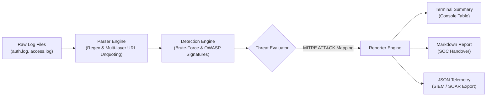

# 🛡️ SOC Log Sentinel (`soc-log-sentinel`)

[](https://www.python.org/)
[](https://opensource.org/licenses/MIT)
[]()
[]()

> **A fast, lightweight Python CLI utility for SOC analysts and incident responders.** Parses authentication and web server logs, identifies brute-force attempts and OWASP Top 10 web injection signatures, and outputs structured incident triage reports in Markdown and SIEM-ready JSON.

---

## 📌 Overview & Key Capabilities

Security Operations Centers (SOCs) and Incident Response teams are constantly tasked with triaging noisy log sources under tight SLAs. **SOC Log Sentinel** provides rapid, automated first-responder log triage without requiring bulky infrastructure:

- **Multi-Format Log Ingestion:**
  - **Linux Auth Logs:** `/var/log/auth.log` and `/var/log/secure` (SSH invalid users, failed passwords, successful logins, sudo authentication failures).
  - **Web Server Logs:** Apache and Nginx Combined Log Format (CLF) with URI parameter decoding.
  - **Auto-Detection:** Automatically classifies log types on-the-fly.
- **Threat Detection Engine:**
  - **SSH / Sudo Brute-Force & Credential Stuffing (`T1110`):** Configurable failed attempt thresholding, targeted user clustering, and credential spraying detection.
  - **OWASP Top 10 Web Injection Signatures:**
    - **SQL Injection (SQLi) (`CWE-89`, `T1190`):** `UNION SELECT`, boolean bypasses (`OR 1=1`), time-based delays (`SLEEP`, `BENCHMARK`), schema extraction.
    - **Cross-Site Scripting (XSS) (`CWE-79`, `T1190`):** `<script>` tags, inline event handlers (`onerror=`, `onload=`), `javascript:` pseudo-protocols.
    - **Path Traversal & LFI (`CWE-22`, `T1083`):** Multi-depth directory climbing (`../../`), encoded traversals (`%2e%2e%2f`), sensitive file targets (`/etc/passwd`, `/etc/shadow`, `win.ini`).
    - **OS Command Injection (RCE) (`CWE-78`, `T1059`):** Command chaining delimiters (`;`, `|`, `&&`, `\``) paired with shell execution primitives (`cat`, `whoami`, `id`, `powershell`).
    - **Server-Side Request Forgery (SSRF) (`CWE-918`, `T1190`):** Cloud metadata exploitation targeting AWS/GCP IMDS (`169.254.169.254`) and loopback bypasses.
- **Dual Reporting Outputs:**
  - **Markdown Triage Report:** Ready-to-read executive briefing and SOC shift handover documentation with metrics, hostile IPs, and containment playbooks.
  - **Structured JSON Telemetry:** Machine-readable output for easy ingestion into SIEMs (Splunk, Elastic, Microsoft Sentinel) or SOAR platforms.

---

## 🏗️ Architecture & Workflow



---

## 📁 Repository Structure

```text
soc-log-sentinel/
├── src/
│   ├── __init__.py         # Package initialization & version metadata
│   ├── cli.py              # CLI entry point, argument parsing & workflow orchestration
│   ├── parser.py           # Regex parsers for auth.log and Apache/Nginx web logs
│   ├── detector.py         # Brute-force & OWASP Top 10 detection engine
│   └── reporter.py         # Markdown, JSON, and terminal summary formatters
├── tests/
│   ├── __init__.py
│   ├── test_parser.py      # Unit tests for log line parsing & edge cases
│   ├── test_detector.py    # Unit tests for brute-force & web injection rules
│   ├── test_reporter.py    # Unit tests for reporting outputs & statistics
│   └── test_cli.py         # End-to-end integration tests
├── sample_logs/
│   ├── auth.log            # Realistic Linux SSH brute-force & login events
│   └── access.log          # Realistic Apache/Nginx web server access logs with attack vectors
├── pyproject.toml          # Build configuration & CLI package entry point
├── requirements.txt        # Development dependencies
├── LICENSE                 # MIT License
└── README.md               # Project documentation
```

---

## 🚀 Installation & Quick Start

### 1. Clone the Repository
```bash
git clone https://github.com/hsan001/soc-log-sentinel.git
cd soc-log-sentinel
```

### 2. Set Up Virtual Environment (Recommended)
```bash
python -m venv .venv

# On Linux / macOS:
source .venv/bin/activate

# On Windows:
.\.venv\Scripts\activate
```

### 3. Install Dependencies
```bash
pip install -r requirements.txt
```

---

## 💻 Usage Examples

### Analyze Sample Logs (Terminal Output)
```bash
python -m src.cli sample_logs/auth.log sample_logs/access.log
```

### Output Markdown and JSON Triage Reports
```bash
python -m src.cli sample_logs/auth.log sample_logs/access.log \
  --output-md triage_report.md \
  --output-json triage_report.json
```

### Adjust Brute-Force Detection Threshold
```bash
# Trigger alerts if 3 or more failed attempts are observed from an IP
python -m src.cli sample_logs/auth.log --threshold 3
```

### Quiet Mode (For Automated CI/CD Pipelines or Cron Jobs)
```bash
python -m src.cli sample_logs/access.log -q -j /var/log/triage.json
```

---

## 📊 Sample Terminal Output

```text
========================================================================
🛡️  SOC LOG SENTINEL — INCIDENT ANALYSIS SUMMARY
========================================================================
Total Logs Analyzed: 21
Alerts Identified:   6
Severity Breakdown:  Critical: 3 | High: 3 | Medium: 0
Attacker IPs:        192.168.1.105, 198.51.100.23, 198.51.100.99, 203.0.113.42, 203.0.113.88, 203.0.113.99
------------------------------------------------------------------------
ID         SEVERITY   CATEGORY                     SOURCE IP        COUNT
------------------------------------------------------------------------
WEB-001    Critical   SQL Injection (SQLi)         203.0.113.42     2
WEB-004    Critical   OS Command Injection (RCE)   203.0.113.88     1
WEB-005    Critical   Server-Side Request Forger   203.0.113.99     1
AUTH-001   High       Credential Spraying / Stuf   192.168.1.105    7
WEB-002    High       Cross-Site Scripting (XSS)   198.51.100.23    2
WEB-003    High       Path Traversal / LFI         198.51.100.99    2
========================================================================
[+] Markdown Incident Report saved to: triage_report.md
[+] JSON Incident Telemetry saved to:   triage_report.json
```

---

## 🧪 Running Unit Tests

SOC Log Sentinel comes with a full unit test suite covering log parsing, injection signature verification, report compilation, and CLI execution.

```bash
pytest -v
```

**Expected Result:**
```text
tests/test_cli.py::test_cli_execution_with_samples PASSED                [  4%]
tests/test_cli.py::test_cli_missing_file PASSED                          [  8%]
tests/test_detector.py::test_auth_brute_force_trigger PASSED             [ 13%]
tests/test_detector.py::test_auth_below_threshold_no_alert PASSED        [ 17%]
tests/test_detector.py::test_credential_stuffing_detection PASSED        [ 21%]
tests/test_detector.py::test_sqli_detection PASSED                       [ 26%]
tests/test_detector.py::test_xss_detection PASSED                        [ 30%]
tests/test_detector.py::test_path_traversal_detection PASSED             [ 34%]
tests/test_detector.py::test_command_injection_detection PASSED          [ 39%]
tests/test_detector.py::test_ssrf_detection PASSED                       [ 43%]
tests/test_detector.py::test_analyze_stream_sorting PASSED               [ 47%]
tests/test_parser.py::test_parse_auth_failed_password PASSED             [ 52%]
tests/test_parser.py::test_parse_auth_accepted PASSED                    [ 56%]
tests/test_parser.py::test_parse_auth_sudo_failure PASSED                [ 60%]
tests/test_parser.py::test_parse_web_combined PASSED                     [ 65%]
tests/test_parser.py::test_parse_web_url_decoding PASSED                 [ 69%]
tests/test_parser.py::test_parse_malformed_lines PASSED                  [ 73%]
tests/test_parser.py::test_detect_and_parse_line PASSED                  [ 78%]
tests/test_parser.py::test_parse_log_file PASSED                         [ 82%]
tests/test_reporter.py::test_compile_metadata PASSED                     [ 86%]
tests/test_reporter.py::test_generate_json_report PASSED                 [ 91%]
tests/test_reporter.py::test_generate_markdown_report PASSED             [ 95%]
tests/test_reporter.py::test_generate_terminal_summary PASSED            [100%]

============================= 23 passed in 0.10s ==============================
```

---

## 📜 MITRE ATT&CK® Mapping Summary

| Alert Category | Technique ID | Technique Name | Tactic |
|---|---|---|---|
| **SSH / Sudo Brute-Force** | `T1110.001` | Password Guessing | Credential Access |
| **Credential Spraying** | `T1110.003` | Password Spraying | Credential Access |
| **SQL Injection (SQLi)** | `T1190` | Exploit Public-Facing Application | Initial Access |
| **Cross-Site Scripting (XSS)** | `T1190` | Exploit Public-Facing Application | Initial Access |
| **Path Traversal / LFI** | `T1083` | File and Directory Discovery | Discovery |
| **OS Command Injection** | `T1059` | Command and Scripting Interpreter | Execution |
| **Server-Side Request Forgery** | `T1190` | Exploit Public-Facing Application | Initial Access / Lateral Movement |

---

## 👨‍💻 Author

**Mohammad Hassan Jalal**
- Specialization: Cybersecurity, Penetration Testing & SOC Operations
- Master of Applied Cybersecurity candidate — University of Wollongong in Dubai (UOWD)
- GitHub: [@hsan001](https://github.com/hsan001)

---

## 📄 License

This project is licensed under the terms of the [MIT License](LICENSE).
