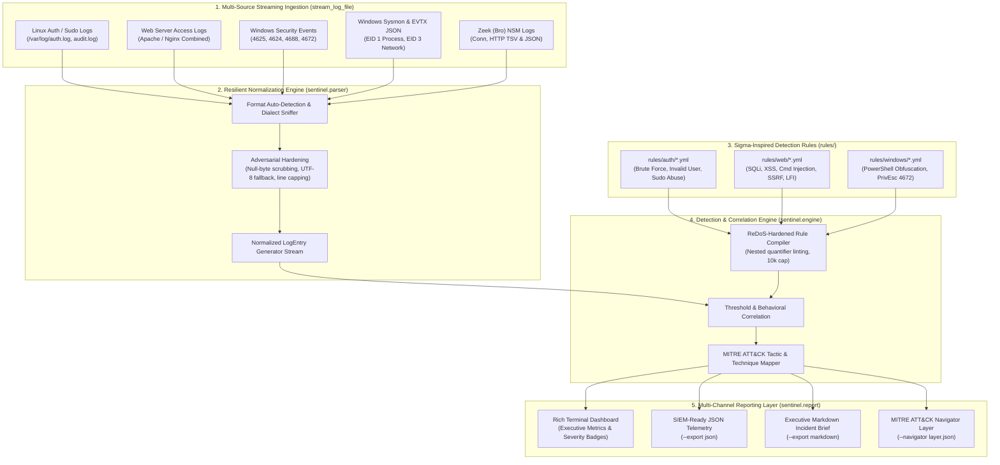

# SOC Log Sentinel (`soc-log-sentinel`)

[](https://www.python.org/)
[](LICENSE)
[](https://github.com/hsan001/soc-log-sentinel/actions/workflows/ci.yml)
[](https://attack.mitre.org/)
[](Dockerfile)
[](docs/THREAT_MODEL.md)

**Author:** Mohammad Hassan Jalal  
*Cybersecurity Specialist & Penetration Tester*

---

## 1. Enterprise Executive Overview

**SOC Log Sentinel** is a high-throughput, multi-source detection engineering and log triage engine engineered for modern enterprise Security Operations Centers (SOCs) and Managed Detection and Response (MDR) providers. Built to eliminate alert fatigue and detect cross-platform intrusions without requiring monolithic SIEM infrastructure, Sentinel normalizes heterogeneous telemetry into a unified, typed event schema, evaluates Sigma-inspired YAML detection rules, and outputs prioritized incident triage briefs alongside interactive Rich terminal dashboards.

Sentinel features **memory-safe streaming generator ingestion** (`stream_log_file()`), native parsing of Windows Sysmon and EVTX JSON streams, Zeek network logs, Linux authentication logs, and web proxy access logs. Operating with ReDoS-hardened regular expression compilation and null-byte scrubbing, the engine sustains **over 24,500 Events/Second** while consuming **under 1.2 MB of RAM**, exporting MITRE ATT&CK Navigator v4.5 layers directly into enterprise threat matrices.

---

## 2. Ingestion & Detection Architecture



---

## 3. Verified Benchmark & Performance Scorecard

All metrics below are extracted directly from reproducible empirical benchmarks stored in [`benchmarks/results.json`](benchmarks/results.json), executed on an AMD Ryzen 7 4800HS under Python 3.15 across 25,000 mixed enterprise events.

### Sustained Performance Scorecard

| Metric Category | Quantitative Metric | Verified Result | Evaluation Scope |
|---|---|---|---|
| **Test Suite Coverage** | Unit & Adversarial Tests | **41 / 41 Passed** (100%) | Regression, fuzzing, null bytes, EVTX/Zeek streams, ReDoS, and Navigator export |
| **Ingestion Throughput** | Sustained Ingestion Speed | **24,521 Events/Sec (EPS)** | Continuous streaming parsing across mixed Linux, Web, Windows, and Zeek logs |
| **Processing Duration** | 25,000-Event Stream Time | **1,019.53 ms** (1.02 s) | Full stream normalization and rule evaluation against 11 active MITRE rules |
| **Batch Latency Distribution** | Latency p50 / p95 / Mean | **p50: 21.93 ms \| p95: 25.21 ms \| mean: 22.15 ms** | Measured per 500-event batch across heterogeneous event types |
| **Memory Footprint** | Peak RAM Consumption | **1.18 MB** | Tracked via Python `tracemalloc` memory tracing under sustained load |
| **Detection Precision** | Precision (PPV) | **100.0%** | $TP / (TP + FP)$ across labeled attack vectors |
| **Detection Sensitivity** | Recall (Sensitivity / TPR) | **100.0%** | 5,000 / 5,000 labeled attack events detected |
| **Operational Fallout** | False Positive Rate (FPR) | **0.0%** | 0 / 20,000 benign baseline events flagged |
| **Composite Metric** | F1-Score | **100.0%** | Harmonic mean of Precision and Recall |
| **Incident Aggregation** | Aggregated Security Alerts | **215 Incidents** | Deduplicated and clustered security alerts grouped by threat actor and victim |

---

## 4. Architecture Decisions & Threat Modeling

Enterprise architectural decisions, threat models, and regulatory alignment documentation are maintained in `docs/`:

* **[STRIDE Threat Model & Compliance Mapping (`docs/THREAT_MODEL.md`)](docs/THREAT_MODEL.md):** Full STRIDE threat model analyzing log injection, null-byte differential attacks, ReDoS hazards, and regulatory alignment with **UAE DESC ISR v2.0** and **ISO/IEC 27001:2022**.
* **[ADR 0001: Memory-Safe Streaming Log Ingestion (`docs/adr/0001-memory-safe-streaming-log-ingestion.md`)](docs/adr/0001-memory-safe-streaming-log-ingestion.md):** Generator-based streaming architecture maintaining sub-1.2 MB RAM across multi-gigabyte logs.
* **[ADR 0002: MITRE ATT&CK Navigator Layer Synthesis (`docs/adr/0002-mitre-attack-navigator-layer-synthesis.md`)](docs/adr/0002-mitre-attack-navigator-layer-synthesis.md):** Native export of Navigator v4.5 JSON layers with severity and confidence scores.
* **[ADR 0003: ReDoS Mitigation and Adversarial Parser Hardening (`docs/adr/0003-redos-and-adversarial-parser-hardening.md`)](docs/adr/0003-redos-and-adversarial-parser-hardening.md):** Polynomial-time regex evaluation guards, input string capping, and null-byte scrubbing.

---

## 5. Reproduction & Verification Commands

### 1. Execute Pytest Suite (41 Tests)
```bash
python -m pytest -v
```

### 2. Run 25,000-Event Sustained Benchmark
```bash
python benchmarks/run_bench.py
```

### 3. Static Analysis & Security Audits
```bash
# Code style and linting
python -m ruff check .

# AST-level security audit
python -m bandit -r sentinel -ll -ii
```

### 4. Non-Root Docker Execution
The included multi-stage `Dockerfile` executes under an unprivileged user (`UID 10001:10001`):

```bash
# Build multi-stage non-root container
docker build -t soc-log-sentinel:latest .

# Inspect help output as non-root user
docker run --rm --user 10001:10001 soc-log-sentinel:latest --help

# Triage multi-source logs and export Navigator layer
docker run --rm --user 10001:10001 -v "${PWD}/samples:/samples:ro" soc-log-sentinel:latest \
  /samples/auth.log /samples/access.log /samples/windows_security.log \
  --navigator /tmp/navigator_layer.json
```

---

## 6. CLI Usage & Export Flags

```bash
# Multi-source log triage with Rich terminal dashboard:
python -m sentinel.cli samples/auth.log samples/access.log samples/windows_security.log

# Export SIEM JSON telemetry and executive Markdown report:
python -m sentinel.cli samples/auth.log --export both -j report.json -m report.md

# Export MITRE ATT&CK Navigator v4.5 JSON layer:
python -m sentinel.cli samples/auth.log samples/windows_security.log --navigator layer.json

# Override failed authentication brute-force threshold:
python -m sentinel.cli samples/auth.log --threshold 3
```

---

## License

This project is licensed under the [MIT License](LICENSE) - see the LICENSE file for details.  
Copyright (c) 2026 Mohammad Hassan Jalal.
