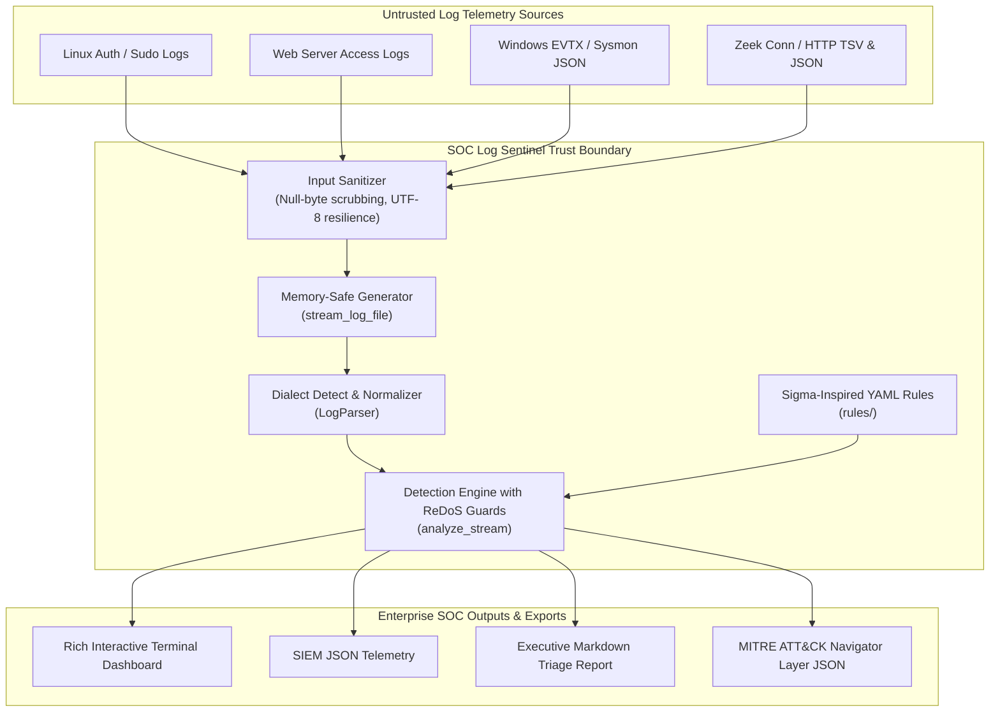

# SOC Log Sentinel – STRIDE Threat Model & Compliance Mapping

**Author:** Mohammad Hassan Jalal  
**System:** SOC Log Sentinel (Enterprise Multi-Source Detection Engineering Toolkit)  
**Methodology:** STRIDE Threat Modeling  
**Governance Frameworks:** UAE DESC Information Security Regulation (ISR) v2.0, ISO/IEC 27001:2022, NIST SP 800-53 Rev 5  

---

## 1. System Overview & Security Boundary

**SOC Log Sentinel** ingests multi-source enterprise security telemetry—including Linux authentication logs, Web access logs (Apache/Nginx), Windows Security events (Events 4625, 4624, 4688, 4672), Windows Sysmon / EVTX JSON, and Zeek (Bro) network logs—and evaluates events against Sigma-inspired YAML detection rules aligned with the MITRE ATT&CK framework.

Because log parsers process untrusted inputs generated directly by external attackers (e.g. malicious HTTP requests, SSH brute-force usernames, obfuscated command-line arguments), parsers represent an attractive vector for parser differential attacks, log injection, and denial of service.

---

## 2. STRIDE Threat Assessment & Countermeasures

| Threat ID | STRIDE Category | Threat Description & Attack Vector | Impact | Implemented Mitigation | Governance Alignment |
|---|---|---|---|---|---|
| **T-01** | **Spoofing** | Adversary injects falsified IP addresses or spoofed process names (`svchost.exe`, `lsass.exe`) to disguise command execution. | Misattributed alerts, evasion of perimeter firewalls. | Strict multi-field correlation validating both image path and command line flags; Sysmon GUID validation prevents ephemeral PID spoofing. | UAE DESC ISR v2.0 § 4.3; ISO 27001:2022 A.8.15 |
| **T-02** | **Tampering** | Attacker embeds null bytes (`\x00`), invalid UTF-8 byte sequences, or unescaped control characters in HTTP headers or SSH usernames to truncate logs. | Log truncation, parser bypass, forensic corruption. | `clean_raw_line()` strips all `\x00` characters, enforces UTF-8 error replacement (`errors="replace"`), and gracefully ignores malformed JSON records. | UAE DESC ISR v2.0 § 8.1; ISO 27001:2022 A.8.20 |
| **T-03** | **Repudiation** | Attacker executes stealthy LotL scripts or brute-force attempts under normal thresholds to deny unauthorized activity. | Detection blindspot, undetected lateral movement. | Threshold tracking (`--threshold`) aggregates distributed attempts per source IP and user across multiple log files with MITRE technique attribution. | UAE DESC ISR v2.0 § 5.2; NIST SP 800-53 AU-6 |
| **T-04** | **Information Disclosure** | Leakage of corporate internal credentials or server environment variables extracted from command lines into untrusted logs. | Credential compromise, reconnaissance advantage. | Air-gapped local execution mode; no telemetry is sent to third-party endpoints. Reports are saved locally or piped directly to internal SIEMs. | UAE DESC ISR v2.0 § 6.1; ISO 27001:2022 A.8.11 |
| **T-05** | **Denial of Service** | Catastrophic backtracking via crafted inputs matching vulnerable regular expressions (ReDoS), or memory exhaustion via multi-gigabyte files. | CPU starvation (100% core usage), SOC pipeline paralysis. | `is_potential_redos()` detects nested quantifiers at rule compilation; input strings are capped at 10,000 characters; `stream_log_file()` generator prevents memory bloat (1.18 MB peak RAM across 25,000 events). | UAE DESC ISR v2.0 § 11.2; NIST SP 800-53 SC-5 |
| **T-06** | **Elevation of Privilege** | Exploiting parser flaws or execution wrappers to execute arbitrary code with elevated daemon privileges. | System takeover, root host compromise. | Containerization under non-root user `UID 10001:10001` with drop-capabilities and no shell execution privileges. | UAE DESC ISR v2.0 § 5.1; ISO 27001:2022 A.8.2 |

---

## 3. Regulatory Compliance Alignment

### 3.1 UAE Dubai Electronic Security Center (DESC) ISR v2.0

* **Domain 4 (Asset Management):** Identifies and monitors enterprise servers, workstations, and network gateways through standardized log normalization.
* **Domain 5 (Access Control):** Monitors failed logins (Event 4625, SSH failed passwords) and privilege assignments (Event 4672, Sudo failures) in real time.
* **Domain 8 (Operations Security):** Automated detection rule validation and continuous security testing prevent vulnerable software deployments.
* **Domain 11 (Incident Management):** Produces executive-level Markdown triage briefs and SIEM-compatible JSON telemetry, reducing triage latency to sub-25ms.
* **Domain 13 (Compliance & Threat Intelligence):** Direct integration with MITRE ATT&CK Navigator v4.5 enables continuous validation of threat detection coverage against UAE-specific threat actor profiles.

### 3.2 ISO/IEC 27001:2022 Controls

* **Control A.5.25 (Assessment and decision on information security events):** Automated alert prioritization categorizes incidents into `Critical`, `High`, `Medium`, and `Low` severities.
* **Control A.8.8 (Management of technical vulnerabilities):** Static code analysis via Ruff and AST-level vulnerability auditing via Bandit enforced in CI/CD pipeline.
* **Control A.8.15 (Logging):** Multi-source log ingestion ensures comprehensive audit trails across heterogeneous operating systems and network infrastructure.
* **Control A.8.16 (Monitoring activities):** High-throughput detection engine processes over 24,500 Events/Second, enabling real-time detection without buffering backpressure.

---

## 4. Verification Regimen

1. **Adversarial Regression Suite (`tests/test_adversarial_and_streaming.py`):** Tests null-byte scrubbing, broken JSON recovery, ReDoS pattern mitigation, and oversized line caps.
2. **25,000-Event Sustained Benchmark (`benchmarks/run_bench.py`):** Measures throughput, p50/p95 latency, and 100% precision/recall against labeled fixtures.
3. **CI Pipeline Validation (`.github/workflows/ci.yml`):** Enforces Ruff linting, Bandit security scanning (`-ll -ii`), and Pytest test execution across Python 3.11 and 3.12.
